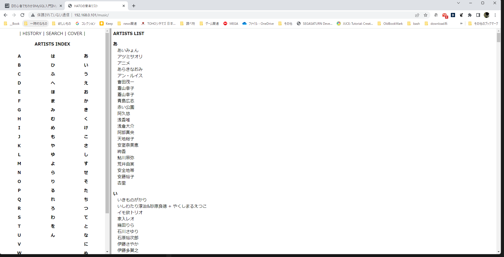
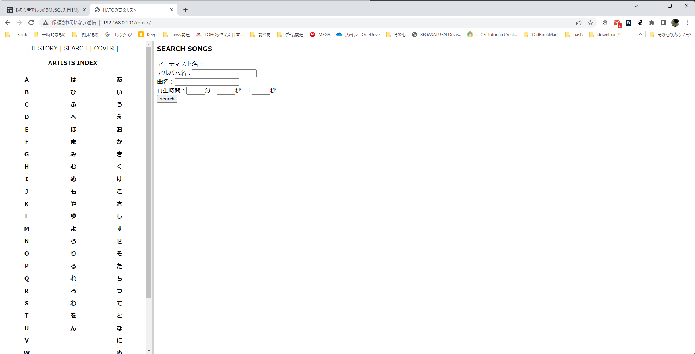

## データベースのデータ構造
# 起動時画面


# 検索画面
 

検索はソースに依存。

### 古いデータ構造
### idは自動インクリメントモードで作成
```
                                  テーブル"album"
        列        | タイプ  | 照合順序 | Null 値を許容 |            デフォルト
------------------+---------+----------+---------------+----------------------
 id               | integer |          | not null      | nextval('album_id_seq'::regclass)
 albumname        | text    |          | not null      |
 albumartist      | integer |          | not null      |
 pseudonymreading | text    |          |               |
 discno           | integer |          |               |

                                  テーブル"artist"
        列        | タイプ  | 照合順序 | Null 値を許容 |             デフォルト
------------------+---------+----------+---------------+----------------------
 id               | integer |          | not null      | nextval('artist_id_seq'::regclass)
 namejpn          | text    |          |               |
 nameeng          | text    |          |               |
 pseudonymreading | text    |          |               |

                                  テーブル"song"
        列        | タイプ  | 照合順序 | Null 値を許容 |            デフォルト
------------------+---------+----------+---------------+----------------------
 id               | integer |          | not null      | nextval('song_id_seq'::regclass)
 songname         | text    |          | not null      |
 pseudonymreading | text    |          |               |
 albumartist      | integer |          | not null      |
 songartist       | integer |          | not null      |
 songlengthstr    | text    |          | not null      |
 songlength       | integer |          | not null      |
 albumid          | integer |          | not null      |
 songno           | integer |          | not null      |

### 新しデータ構造(考え中)
