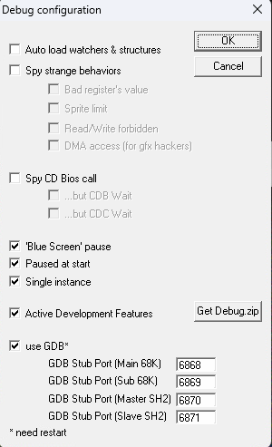

# MegaDrive開発方法

### MegaDriveの開発には[SGDK](https://github.com/Stephane-D/SGDK/releases)を使用します。このドキュメント作成時は2.11を使用しています。

- 作業用ディレクトリを作成します。　ex1. %HOMEPATH%\SGDK_work 
- [SGDK2.11](https://github.com/Stephane-D/SGDK/releases/download/v2.11/sgdk211.7z)を取得して、ex1.の下に解凍。もしくはこのディレクトリに[SGDK git](https://github.com/hiroshica/SGDK.git)をクローンします。
- [個人各種サンプル](https://github.com/hiroshica/MegaDriveSamples.git)をex1.の下にクローンしてください。
- システム環境変数に　SGDK_HOME = ex1.を設定する
- システム環境変数のPATHに　”%SGDK_HOME%\SGDK\bin”と”%SNDDEVTOP%\toolbin”を追加する
- 個人各種サンプルディレクトリの"develop_setup.bat"を実行する

### 実行環境（エミュレータ）
- デバッグ機能付きエミュレータを落としてくる　https://segaretro.org/Gens_KMod
- 以下のスクリーンショットの設定を行う（画面の出し方はOption->Debugで）
 
- [テスト環境](https://github.com/sasayaki-japan/MDTracer-Genesis-megadrive-Emulator)をクローンしてビルドする。

### 以上で基本設定は終わりです。
[ProjectおよびVSCodeの設定](./Project_VSCode.md) 

C:\Program Files\PlasticSCM5\server;C:\Program Files\PlasticSCM5\client;C:\Program Files\PowerShell\7;C:\Program Files\AMD\CIM\Bin64;C:\Program Files\AMD\Performance Profile Client;C:\Program Files\Microsoft\jdk-11.0.16.101-hotspot\bin;C:\Program Files\Microsoft\jdk;%SystemRoot%\system32;%SystemRoot%;%SystemRoot%\System32\Wbem;%SYSTEMROOT%\System32\WindowsPowerShell\v1.0\;%SYSTEMROOT%\System32\OpenSSH\;C:\Program Files\Git\cmd;C:\Program Files\dotnet\;C:\Program Files (x86)\Windows Kits\10\Windows Performance Toolkit\;C:\Program Files\Microsoft SQL Server\150\Tools\Binn\;C:\Program Files\Microsoft SQL Server\Client SDK\ODBC\170\Tools\Binn\;